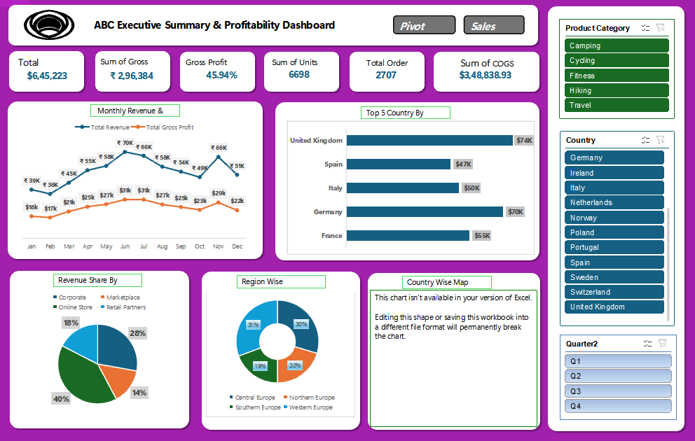

# 📊 Excel Sales & Profitability Dashboard

An interactive **Sales & Profitability Dashboard built in Microsoft Excel** to analyze revenue, gross profit, orders, units sold, cost of goods sold, countries, regions, product categories, and sales channels.

## 📌 Project Overview

This project demonstrates how Excel can be used for **business reporting, KPI analysis, data visualization, and interactive dashboard development**.

The dashboard provides management-level insights through Pivot Tables, Pivot Charts, KPIs, and interactive Slicers.

## 📊 Key KPIs

| KPI | Value |
|---|---:|
| Total Revenue | ₹6,45,223 |
| Gross Profit | ₹2,96,384 |
| Gross Margin | 45.94% |
| Total Units | 6,698 |
| Total Orders | 2,707 |
| Total COGS | ₹3,48,838.93 |

## 📈 Dashboard Analysis

The dashboard includes:

- Monthly Revenue & Gross Profit Trend
- Top 5 Countries by Revenue
- Revenue Share by Sales Channel
- Region-wise Revenue Analysis
- Country-wise Analysis
- Product Category Analysis
- Quarterly Analysis
- Interactive Country Slicer
- Product Category Slicer
- Quarter Slicer

## 🛠️ Tools & Techniques

- Microsoft Excel
- Pivot Tables
- Pivot Charts
- Slicers
- KPI Cards
- Data Analysis
- Data Visualization
- Dashboard Design
- Business Reporting

## 🎯 Business Insights

The dashboard helps users quickly understand:

- Overall revenue and profitability
- Monthly sales and profit trends
- Top-performing countries
- Revenue contribution by sales channel
- Regional performance
- Product-category performance
- Quarterly business performance

## 📷 Dashboard Preview

## 💼 Skills Demonstrated

This project demonstrates practical skills in:

**Excel Analytics | MIS Reporting | KPI Reporting | Business Analytics | Data Visualization | Dashboard Development**

## 👨‍💻 Author

**Arman Borkar**

Aspiring Data Analyst | MIS Executive | MIS Reporting

---
⭐ If you find this project useful, feel free to explore the repository.
